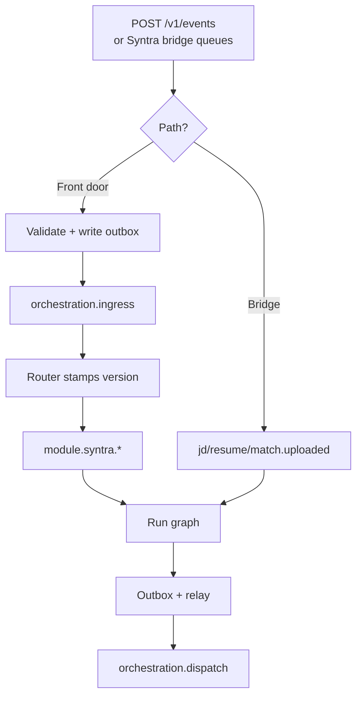
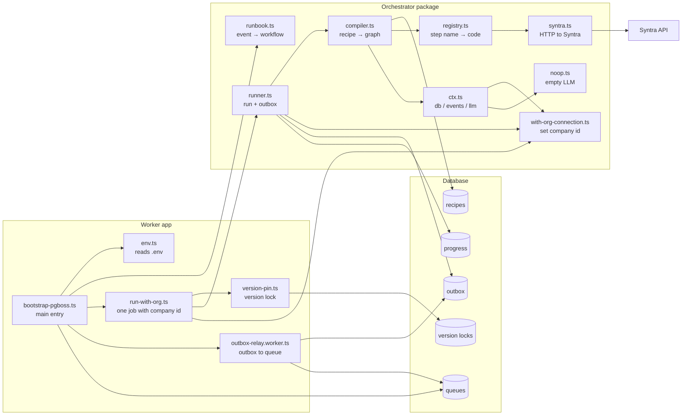

# Orchestrator workflow & file map (simple)

**What this is:** Pictures of the live Syntra path, plus which file does what.  
**Updated:** 2026-08-10  
**Not about:** Recruiter Copilot / Kafka

Also see: `plan.md`, `STATUS_TRACKER.md`, `ORCHESTRATOR_AUDIT.md`, `FRONT_DOOR.md`

---

## Workflow (design front door)

**One line:** Event → ingress (or Syntra bridge) → router/modules → run → outbox → relay.

Also see **`FRONT_DOOR.md`**.

---

## Which files talk to which

---

## This file does that

| File | Plain job |
|------|-----------|
| `apps/worker/src/bootstrap-pgboss.ts` | Starts worker; listens to queues; starts a job |
| `apps/worker/src/env.ts` | Reads `.env` |
| `apps/worker/src/run-with-org.ts` | Runs one job with company id set |
| `apps/worker/src/version-pin.ts` | Remembers which recipe version this job uses |
| `apps/worker/src/workers/outbox-relay.worker.ts` | Moves outbox rows onto the dispatch queue |
| `packages/orchestrator/src/resolver/runbook.ts` | Maps event type → workflow name |
| `packages/orchestrator/src/workflow/runner.ts` | Runs the graph; writes the outbox |
| `packages/orchestrator/src/graphs/compiler.ts` | Reads recipe from DB; builds the runnable graph |
| `packages/orchestrator/src/graphs/definition.ts` | Shape of a recipe |
| `packages/orchestrator/src/nodes/registry.ts` | Step name → actual function |
| `packages/orchestrator/src/nodes/syntra.ts` | Calls Syntra for JD / resume / match |
| `packages/orchestrator/src/nodes/ctx.ts` | Gives each step db + events + empty LLM |
| `packages/orchestrator/src/db/with-org-connection.ts` | Sets company id for DB work |
| `packages/orchestrator/src/llm/noop.ts` | Placeholder LLM (does nothing useful yet) |
| `packages/orchestrator/src/graphs/defs/*.def.ts` | Recipe files (workflow wiring in git) |
| `packages/orchestrator/src/graphs/define-graph.ts` | Helper to author + validate a recipe |
| `packages/orchestrator/src/ingress/accept-platform-event.ts` | Front door: validate + outbox + ingress queue |
| `apps/worker/src/workers/ingress-router.worker.ts` | Router: ingress → module.* + version stamp |
| `apps/worker/src/workers/module-execute.worker.ts` | Runs workflows from module.* |
| `apps/api/src/index.ts` | HTTP `POST /v1/events` |

---

## Not used on the live path

| File | Note |
|------|------|
| `workflow/graphs/syntra.ts` | Old hardcoded graphs — we prefer DB recipes |
| Empty stubs (`runbooks/*`, `policy/*`, …) | Not wired into Syntra yet |
