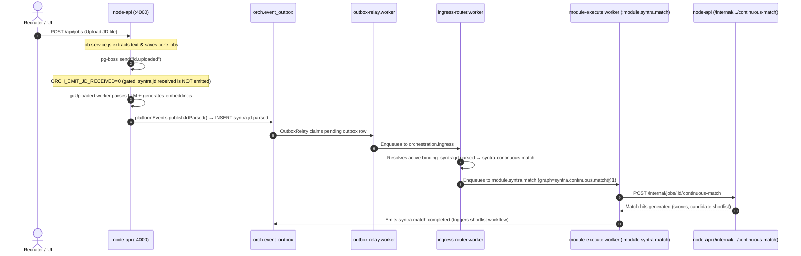

# DEV Orchestration Gap Audit

## 1. Baseline

- **Current Branch:** `dev/benchsales-platform-v2`
- **Current Baseline HEAD:** `4b2ae8a8abb0944c8097140b552ba21091c8204b`
- **Commit Subject:** `Ignore the local reference folder and the old-project checkout`
- **Commit Author:** `SuhasGangireddy <suhasgangireddy@gmail.com>`
- **Working Tree State:** Clean tracking branch (no staged or committed modifications; only untracked local scripts `e HEAD` and `packages/orchestrator/scripts/manual-run.ts`).

---

## 2. Current Health

### Preflight (`npm run dev:preflight`)
- **Status:** **FAIL (Informational)**
- **Output:**
  ```
  preflight — something from a previous run is still up.
    :4000 is taken — SYNTRA api (dev:syntra-api)
    :3005 is taken — RELAY smart inbox (dev:relay)
    :3000 is taken — SYNTRA front (dev:syntra-ui)
    :4100 is taken — orchestrator ingress (dev:orch-api)
    :4200 is taken — authoring api (dev:admin-api)
    :5173 is taken — authoring ui (dev:admin-ui)
    worker already running — pid 40648, started 09/22/2026 13:37:08
  ```
- **Context:** Local developer stack is actively running concurrently for manual verification.

### Node Registry Check (`npm run check:registry`)
- **Status:** **PASS**
- **Output:**
  ```
  registry:check — 11 node files, 11 listed in adapters/index.ts
    ok   every contract is where its key says, unique, and loaded.
  ```

### Node Registry Materialization (`npm run materialize:nodes -w @tekisho/worker`)
- **Status:** **PASS with warnings**
- **Output:**
  ```
  11 row(s) in node_registry are not in the code any more:
     orch.switch@1
     prism.confirmation.record@1
     prism.consent.record@1
     prism.profile.mask@1
     prism.rtr.record@1
     prism.submission.open@1
     prism.submission.transition@1
     prism.vendor.record@1
     relay.consent.remind@1
     relay.consent.send@1
     relay.profile.send@1
  Remove them deliberately; this script does not delete.

  node_registry materialized:
     contract  20
     declared  2
     legacy    11
  ```

### Platform Checks (`npm run check:platform`)
- **Status:** **FAIL** (2 check failures)
  - `bindings_routable`: **PASS** (12 active bindings on active queues)
  - `impls_permitted`: **PASS** (all steps in 11 active graphs are valid)
  - `routing_hazards`: **PASS** (no control-plane / resume collisions)
  - `work_not_duplicated`: **PASS** (no duplicate work across chains)
  - `live_means_reachable`: **FAIL**
    - `syntra.jd.received → syntra.jd.workflow is bound, but that workflow has no live version`
  - `emitted_events_answered`: **FAIL**
    - 19 published events nothing answers (including `[object Object]` from `astra.route.decision` and 10 PRISM/RELAY events from stale DB rows)

### Workspace Test Suite (`npx vitest run`)
- **Status:** **PASS**
- **Output:** 42 test files passed, 568 tests passed, 0 failures across all packages.

---

## 3. Node Registry Findings

### Complete Inventory & State Reconciliation

| Node Key | Domain | Source File | Adapter Exists? | Runtime Impl Exists? | DB Row Exists? | DB Source / Type | Used By Active Workflow? | Status | Required Action |
|---|---|---|---|---|---|---|---|---|---|
| `syntra.jd.process` | SYNTRA | [adapters/syntra/nodes/jd-process.node.ts](file:///c:/Users/SUNITHA/Downloads/benchsales-suhas-code/Bench-Sales/adapters/syntra/nodes/jd-process.node.ts) | Yes | Yes (contract + engine) | Yes | CONTRACT | No (retired workflow) | Obsolete in intake | Keep contract; do not resurrect workflow |
| `syntra.resume.process` | SYNTRA | [adapters/syntra/nodes/resume-process.node.ts](file:///c:/Users/SUNITHA/Downloads/benchsales-suhas-code/Bench-Sales/adapters/syntra/nodes/resume-process.node.ts) | Yes | Yes (contract + engine) | Yes | CONTRACT | Yes (`resume.intake`) | Active & Live | None |
| `syntra.match.process` | SYNTRA | [adapters/syntra/nodes/match-process.node.ts](file:///c:/Users/SUNITHA/Downloads/benchsales-suhas-code/Bench-Sales/adapters/syntra/nodes/match-process.node.ts) | Yes | Yes (contract + engine) | Yes | CONTRACT | Yes (`syntra.match.workflow`) | Active & Live | None |
| `syntra.continuous.match` | SYNTRA | [adapters/syntra/nodes/continuous-match.node.ts](file:///c:/Users/SUNITHA/Downloads/benchsales-suhas-code/Bench-Sales/adapters/syntra/nodes/continuous-match.node.ts) | Yes | Yes (contract + engine) | Yes | CONTRACT | Yes (`syntra.continuous.match`) | Active & Live | None (Core JD intake engine) |
| `syntra.duplicate.detect` | SYNTRA | [adapters/syntra/nodes/duplicate-detect.node.ts](file:///c:/Users/SUNITHA/Downloads/benchsales-suhas-code/Bench-Sales/adapters/syntra/nodes/duplicate-detect.node.ts) | Yes | Yes (contract + engine) | Yes | CONTRACT | Yes (`syntra.duplicate.detect`) | Active & Live | None |
| `syntra.bench.alert` | SYNTRA | [adapters/syntra/nodes/bench-alert.node.ts](file:///c:/Users/SUNITHA/Downloads/benchsales-suhas-code/Bench-Sales/adapters/syntra/nodes/bench-alert.node.ts) | Yes | Yes (contract + engine) | Yes | CONTRACT | Yes (`syntra.profile.pipeline`) | Active & Live | None |
| `syntra.shortlist.notify` | SYNTRA | [adapters/syntra/nodes/shortlist-notify.node.ts](file:///c:/Users/SUNITHA/Downloads/benchsales-suhas-code/Bench-Sales/adapters/syntra/nodes/shortlist-notify.node.ts) | Yes | Yes (contract + engine) | Yes | CONTRACT | Yes (`syntra.shortlist.workflow`) | Active & Live | None |
| `syntra.duplicate.merge` | SYNTRA | [adapters/syntra/nodes/duplicate-merge.node.ts](file:///c:/Users/SUNITHA/Downloads/benchsales-suhas-code/Bench-Sales/adapters/syntra/nodes/duplicate-merge.node.ts) | Yes | Yes (contract + engine) | Yes | CONTRACT | Yes (`duplicate.review`) | Active & Live | None |
| `syntra.run.retry` | SYNTRA | [adapters/syntra/nodes/run-retry.node.ts](file:///c:/Users/SUNITHA/Downloads/benchsales-suhas-code/Bench-Sales/adapters/syntra/nodes/run-retry.node.ts) | Yes | Yes (contract + engine) | Yes | CONTRACT | Yes (`syntra.run.retry.workflow`) | Active & Live | None |
| `human.gate` | Platform | [adapters/platform/nodes/human-gate.node.ts](file:///c:/Users/SUNITHA/Downloads/benchsales-suhas-code/Bench-Sales/adapters/platform/nodes/human-gate.node.ts) | Yes | Yes (engine interrupt) | Yes | DECLARED | Yes (`duplicate.review`) | Active & Live | None |
| `orch.branch.decision` | Platform | [adapters/platform/nodes/branch-decision.node.ts](file:///c:/Users/SUNITHA/Downloads/benchsales-suhas-code/Bench-Sales/adapters/platform/nodes/branch-decision.node.ts) | Yes | Yes (engine branch) | Yes | DECLARED | Yes (`duplicate.review`) | Active & Live | None |
| `astra.requirement.intake` | ASTRA | None (missing adapter) | No | Yes (`astra.ts`) | Yes | LEGACY | No | Legacy | Author adapter contract |
| `astra.requirement.ingest` | ASTRA | None (missing adapter) | No | Yes (`astra.ts`) | Yes | LEGACY | No | Legacy | Author adapter contract |
| `astra.jobboard.fetch` | ASTRA | None (missing adapter) | No | Yes (`astra.ts`) | Yes | LEGACY | No | Legacy | Author adapter contract |
| `astra.requirement.quality` | ASTRA | None (missing adapter) | No | Yes (`astra.ts`) | Yes | LEGACY | No | Legacy | Author adapter contract |
| `astra.requirement.normalize` | ASTRA | None (missing adapter) | No | Yes (`astra.ts`) | Yes | LEGACY | No | Legacy | Author adapter contract |
| `astra.route.decision` | ASTRA | None (missing adapter) | No | Yes (`astra.ts`) | Yes | LEGACY | No | Legacy (has config emit bug) | Author contract with schema |
| `orbit.lifecycle.transition` | ORBIT | None (missing adapter) | No | Yes (`orbit.ts`) | Yes | LEGACY | Yes (`orbit.lifecycle.workflow`) | Active & Live (Legacy) | Author adapter contract |
| `orbit.placement.confirm` | ORBIT | None (missing adapter) | No | Yes (`orbit.ts`) | Yes | LEGACY | Yes (`orbit.placement.workflow`) | Active & Live (Legacy) | Author adapter contract |
| `orbit.revenue.arrange` | ORBIT | None (missing adapter) | No | Yes (`orbit.ts`) | Yes | LEGACY | Yes (`orbit.revenue.workflow`) | Active & Live (Legacy) | Author adapter contract |
| `orbit.activity.note` | ORBIT | None (missing adapter) | No | Yes (`orbit.ts`) | Yes | LEGACY | Yes (`orbit.activity.workflow`) | Active & Live (Legacy) | Author adapter contract |
| `orbit.route.decision` | ORBIT | None (missing adapter) | No | Yes (`orbit.ts`) | Yes | LEGACY | No | Legacy | Author adapter contract |
| `orch.switch` | Platform | None | No | No | Yes | CONTRACT | No (only retired flow) | Stale DB Row | Keep in DB until P1 contract lands |
| `prism.confirmation.record` | PRISM | None | No | No | Yes | CONTRACT | No | Stale DB Row | Keep in DB until P1 contract lands |
| `prism.consent.record` | PRISM | None | No | No | Yes | CONTRACT | No | Stale DB Row | Keep in DB until P1 contract lands |
| `prism.profile.mask` | PRISM | None | No | No | Yes | CONTRACT | No | Stale DB Row | Keep in DB until P1 contract lands |
| `prism.rtr.record` | PRISM | None | No | No | Yes | CONTRACT | No | Stale DB Row | Keep in DB until P1 contract lands |
| `prism.submission.open` | PRISM | None | No | No | Yes | CONTRACT | No | Stale DB Row | Keep in DB until P1 contract lands |
| `prism.submission.transition`| PRISM | None | No | No | Yes | CONTRACT | No | Stale DB Row | Keep in DB until P1 contract lands |
| `prism.vendor.record` | PRISM | None | No | No | Yes | CONTRACT | No | Stale DB Row | Keep in DB until P1 contract lands |
| `relay.consent.remind` | RELAY | None | No | No | Yes | CONTRACT | No | Stale DB Row | Keep in DB until P1 contract lands |
| `relay.consent.send` | RELAY | None | No | No | Yes | CONTRACT | No | Stale DB Row | Keep in DB until P1 contract lands |
| `relay.profile.send` | RELAY | None | No | No | Yes | CONTRACT | No | Stale DB Row | Keep in DB until P1 contract lands |

---

### Detailed Analysis of the 11 Stale DB Rows

1. **Why does the DB row exist?**  
   On `2026-09-21 01:49 UTC`, `materialize-node-registry.ts` was executed against this shared Supabase database from a working copy that defined node contracts for PRISM, RELAY, and `orch.switch`.
2. **Which workflow references it?**  
   - Only `orch.switch` is referenced in any version definition: `custom.ab03-runtime-9e39460e.5a55d17c.authored` (version 1), which has status `retired`.  
   - Zero active workflows reference any of the 11 nodes.
3. **Which binding references it?**  
   None. Bindings connect events to graph keys, not directly to node keys.
4. **Is there an old/legacy implementation?**  
   No. PRISM and RELAY were not engine built-in nodes; they communicate with standalone services (`node-api/src/modules/prism` and `apps/relay`).
5. **Is there a newer expected implementation?**  
   Yes. These 11 nodes represent the forward integration contracts for PRISM, RELAY, and platform switching required for Phase 2 integration.
6. **Is the row safe to retire?**  
   Yes, retiring them is safe as zero active graphs reference them. However, they should **not** be deleted simply to silence `check:platform` or `materialize:nodes`, because their schemas are already aligned with target contracts.
7. **What evidence is required before deletion/action?**  
   Verify that no draft graph in `authoring.graph_drafts` references them and that no active binding consumes their emitted events. Rather than deleting, the correct action in Phase 2 is to restore their adapter source files in `adapters/prism`, `adapters/relay`, and `adapters/platform`.

---

## 4. Event Routing Findings

### Classification of the 19 Unanswered Emitted Events

| # | Emitted Event | Publishing Node | Category | Code & Catalog Evidence | Required Action |
|---|---|---|---|---|---|
| 1 | `astra.requirement.normalized` | `astra.requirement.normalize` | **C. Audit/UI event** | Emitted upon normalization; inside ASTRA graphs, next step `astra.route.decision` consumes state directly. | Document as terminal/audit; no external workflow required. |
| 2 | `orbit.placement.confirmed` | `orbit.placement.confirm` | **B. Terminal event** | End of placement lifecycle; consumed by audit feed and dashboard. | Mark `handling = 'terminal'` in catalog. |
| 3 | `orbit.activity.noted` | `orbit.activity.note` | **B. Terminal event** | End of activity note creation; consumed by activity stream. | Mark `handling = 'terminal'` in catalog. |
| 4 | `orbit.lifecycle.transitioned`| `orbit.lifecycle.transition` | **B. Terminal event** | Candidate stage update; UI notification only. | Mark `handling = 'terminal'` in catalog. |
| 5 | `orbit.bench.hold` | `orbit.route.decision` | **B. Terminal event** | Candidate paused on bench. | Mark `handling = 'terminal'` in catalog. |
| 6 | `astra.requirement.scored` | `astra.requirement.quality` | **B. Terminal event** | Quality scoring result for requirement audit. | Mark `handling = 'terminal'` in catalog. |
| 7 | `orbit.revenue.arranged` | `orbit.revenue.arrange` | **B. Terminal event** | Financial terms logged. | Mark `handling = 'terminal'` in catalog. |
| 8 | `[object Object]` (`onActionable`) | `astra.route.decision` | **F. Malformed metadata handling** | Checker reads `{ fromConfig: "onActionable" }` as string; defaults to `syntra.jd.normalized`. | Fix `platform-checks.ts` string guard; bind `syntra.jd.normalized` if intake chained. |
| 9 | `[object Object]` (`onRejected`) | `astra.route.decision` | **F. Malformed metadata handling** | Checker reads `{ fromConfig: "onRejected" }` as string; defaults to `astra.requirement.rejected`. | Fix `platform-checks.ts` string guard. |
| 10 | `relay.consent.completed` | `relay.consent.send` | **D. Legacy / E. Missing downstream** | Candidate confirmed consent email; triggers PRISM submission. | Stale DB node declaration; implement downstream workflow binding when RELAY adapter is added. |
| 11 | `relay.profile.completed` | `relay.profile.send` | **D. Legacy / B. Terminal event** | Profile email dispatched to vendor. | Mark terminal or downstream audit. |
| 12 | `prism.submission.opened` | `prism.submission.open` | **D. Legacy / A. Triggers workflow** | Submission opened; should trigger consent check. | Downstream workflow binding in Phase 2. |
| 13 | `prism.consent.recorded` | `prism.consent.record` | **D. Legacy / B. Terminal event** | Legal consent audit record. | Mark terminal / audit. |
| 14 | `prism.vendor.recorded` | `prism.vendor.record` | **D. Legacy / B. Terminal event** | Vendor submission audit record. | Mark terminal / audit. |
| 15 | `prism.submission.transitioned`| `prism.submission.transition`| **D. Legacy / B. Terminal event** | Submission state changed. | Mark terminal / audit. |
| 16 | `prism.rtr.recorded` | `prism.rtr.record` | **D. Legacy / B. Terminal event** | Right-To-Represent signed audit record. | Mark terminal / audit. |
| 17 | `relay.consent.reminded` | `relay.consent.remind` | **D. Legacy / B. Terminal event** | Follow-up reminder sent. | Mark terminal / audit. |
| 18 | `prism.profile.masked` | `prism.profile.mask` | **D. Legacy / A. Triggers workflow** | Resume redacted; ready for dispatch. | Downstream workflow binding in Phase 2. |
| 19 | `prism.confirmation.recorded`| `prism.confirmation.record`| **D. Legacy / B. Terminal event** | Client interview confirmed. | Mark terminal / audit. |

---

## 5. SYNTRA JD Flow

### Current Execution Path



### Identification of the Broken / Stale Component
1. **Broken / Dangling Row:** In `authoring.event_bindings`, the row `8b586e36-add5-45dd-ba02-12be1ee87cd2` (`syntra.jd.received` → `syntra.jd.workflow`) is active, but `syntra.jd.workflow` has **0 live versions** (its only version is `retired`).
2. **Obsolete Workflow:** `syntra.jd.workflow` was designed to execute `syntra.jd.process`, calling `POST /internal/jobs/:id/process`. However, `node-api` already performs parsing during `jdUploaded.worker` and directly publishes `syntra.jd.parsed`. If `syntra.jd.workflow` were revived, parsing would execute twice per upload.
3. **Verdict:** `syntra.jd.workflow` is **OBSOLETE**. It must **NOT** be resurrected. The active binding must be retired.

---

## 6. ASTRA Route Decision: Root Cause of `[object Object]`

### Source Code Defect
In [`apps/admin-api/src/lib/platform-checks.ts#L343-L350`](file:///c:/Users/SUNITHA/Downloads/benchsales-suhas-code/Bench-Sales/apps/admin-api/src/lib/platform-checks.ts#L343-L350):

```typescript
  const bound = new Set(facts.bindings.map((b) => b.eventType));
  const orphans: string[] = [];
  for (const r of declared) {
    for (const ev of r.emits!) {
      if (!bound.has(ev)) orphans.push(`${r.key} publishes ${ev} — nothing answers it`);
    }
  }
```

### Trace:
1. `astra.route.decision` defines dynamic emits in its contract schema:
   ```json
   "emits": [
     { "fromConfig": "onActionable" },
     { "fromConfig": "onRejected" }
   ]
   ```
2. In `platform-facts.ts`, `authoring.node_registry.emits` is read directly as JSON.
3. In `checkEmittedEventsAnswered`, the loop assumes every element `ev` in `r.emits` is a primitive `string`.
4. When `ev` is `{ fromConfig: "onActionable" }`, `${ev}` in string interpolation evaluates to `"[object Object]"`.
5. `bound.has(ev)` checks if a `Set<string>` contains an object, which always returns `false`.
6. Contrast with Check 6 ([`platform-checks.ts#L490-L491`](file:///c:/Users/SUNITHA/Downloads/benchsales-suhas-code/Bench-Sales/apps/admin-api/src/lib/platform-checks.ts#L490-L491)), which correctly guards:
   ```typescript
   if (typeof event !== "string") continue;
   ```
7. **Correct Behavior:** Check 4 must skip non-string `{ fromConfig }` entries when auditing static bindings, or resolve them against default configuration.

---

## 7. Module Adapter Matrix

| Module | Contracts Implemented | Adapter Files in `adapters/` | Runtime Loaded | Registry DB State | Status | Missing Pieces |
|---|---|---|---|---|---|---|
| **SYNTRA** | 9 contracts | 9 files in `adapters/syntra/nodes/` | Yes (`apps/worker/src/node-registry.ts`) | 9 rows (`source = 'contract'`) | Complete | None |
| **PLATFORM** | 2 declarations | 2 files in `adapters/platform/nodes/` | Yes (engine built-ins) | 2 rows (`source = 'declared'`) | Functional | `orch.switch` contract missing from code |
| **ASTRA** | 0 contracts (6 engine legacy) | 0 files (`adapters/astra/nodes/` is empty) | Yes (legacy engine `astra.ts`) | 6 rows (`source = 'legacy'`) | Legacy Engine | 6 node contracts in `adapters/astra/nodes/` |
| **ORBIT** | 0 contracts (5 engine legacy) | 0 files (no `adapters/orbit/` dir) | Yes (legacy engine `orbit.ts`) | 5 rows (`source = 'legacy'`) | Legacy Engine | 5 node contracts in `adapters/orbit/nodes/` |
| **RELAY** | 0 contracts in git | 0 files | No | 3 rows (`source = 'contract'`) | Stale in DB, Missing in Git | 3 node contracts in `adapters/relay/nodes/` |
| **PRISM** | 0 contracts in git | 0 files | No | 7 rows (`source = 'contract'`) | Stale in DB, Missing in Git | 7 node contracts in `adapters/prism/nodes/` |

---

## 8. Graph Runtime Matrix

| Capability | DEV Support Status | Evidence in Code | Gap / Target Alignment |
|---|---|---|---|
| **Node Outputs** | **IMPLEMENTED IN DEV** | [`packages/orchestrator/src/nodes/from-contract.ts#L118-L121`](file:///c:/Users/SUNITHA/Downloads/benchsales-suhas-code/Bench-Sales/packages/orchestrator/src/nodes/from-contract.ts#L118-L121) (`steps: { [ctx.nodeId]: checked }`) | None. Fully supported in engine state. |
| **inputMap** | **IMPLEMENTED IN DEV** | [`packages/orchestrator/src/graphs/resolve-inputs.ts#L65-L105`](file:///c:/Users/SUNITHA/Downloads/benchsales-suhas-code/Bench-Sales/packages/orchestrator/src/graphs/resolve-inputs.ts#L65-L105) (`withResolvedInputs()`) | None. Maps `trigger.*` and `stepId.*` into node payload. |
| **conditionalEdges** | **IMPLEMENTED IN DEV** | [`packages/orchestrator/src/graphs/compiler.ts#L549-L568`](file:///c:/Users/SUNITHA/Downloads/benchsales-suhas-code/Bench-Sales/packages/orchestrator/src/graphs/compiler.ts#L549-L568) (`ROUTER_REGISTRY`) | None. Evaluates routers and routes across branches. |
| **Fan-out (Event)** | **IMPLEMENTED IN DEV** | [`packages/routing-contract/src/resolve-routes.ts`](file:///c:/Users/SUNITHA/Downloads/benchsales-suhas-code/Bench-Sales/packages/routing-contract/src/resolve-routes.ts); [`ingress-router.worker.ts#L201-L205`](file:///c:/Users/SUNITHA/Downloads/benchsales-suhas-code/Bench-Sales/apps/worker/src/workers/ingress-router.worker.ts#L201-L205) | Multiple application bindings fire distinct jobs per event. |
| **Fan-in / Join** | **PARTIAL IN DEV** | Basic LangGraph converge-to-node; no barrier synchronization | Target join primitive (`joinOn`) missing from graph schema. |
| **joinOn** | **MISSING** | Grep yielded zero matches across DEV | Defined in P1-P5 target architecture; absent from DEV. |
| **Human Gate / PARKED**| **IMPLEMENTED IN DEV** | [`packages/orchestrator/src/nodes/human-gate.ts`](file:///c:/Users/SUNITHA/Downloads/benchsales-suhas-code/Bench-Sales/packages/orchestrator/src/nodes/human-gate.ts); `compiler.ts#L479` (`interrupt()`) | None. Parks run and checkpoints thread in Postgres. |
| **Resume** | **IMPLEMENTED IN DEV** | [`apps/worker/src/workers/resume-thread.worker.ts`](file:///c:/Users/SUNITHA/Downloads/benchsales-suhas-code/Bench-Sales/apps/worker/src/workers/resume-thread.worker.ts) (`RESUME_THREAD_QUEUE`) | Resumes parked LangGraph checkpoints via event ingress. |
| **Retries** | **IMPLEMENTED IN DEV** | [`apps/worker/src/workers/module-execute.worker.ts#L43`](file:///c:/Users/SUNITHA/Downloads/benchsales-suhas-code/Bench-Sales/apps/worker/src/workers/module-execute.worker.ts#L43) (`MODULE_SEND_OPTIONS`) | pg-boss retryLimit 5 with exponential backoff. |
| **Idempotency** | **IMPLEMENTED IN DEV** | [`packages/orchestrator/src/nodes/idempotency.ts`](file:///c:/Users/SUNITHA/Downloads/benchsales-suhas-code/Bench-Sales/packages/orchestrator/src/nodes/idempotency.ts); `pgDedupeStore` | Claims execution keys to prevent duplicate intra-flow work. |
| **Execution Timeout** | **PARTIAL IN DEV** | Stated in contract (`execution.timeoutMs`) | Declared in metadata; not wrapped with `Promise.race` in runner. |
| **Heartbeat** | **MISSING** | No heartbeat table or ping worker in DEV | Stale worker detection relies solely on pg-boss lease expiration. |
| **Stale Recovery** | **PARTIAL IN DEV** | pg-boss auto-reclaims expired jobs | No orchestrator-level run reconciler for crashed worker processes. |
| **DLQ / Replay** | **IMPLEMENTED IN DEV** | `orch.run_failures` (view `public.failed_workflows`); `syntra.run.retry.workflow` | Hard system errors recorded; retry workflow active. |

---

## 9. Migration Gaps

Only one database migration is required to align DEV database state with code:

### Migration 1: Retire Dangling Binding (`syntra.jd.received`)
- **File:** `packages/db/migrations/V20260909.71__retire_dangling_jd_received_binding.sql`
- **Rationale:** Resolves the `live_means_reachable` failure without deleting history or dropping schemas.
- **SQL Content:**
  ```sql
  BEGIN;

  UPDATE authoring.event_bindings b
     SET status = 'retired', updated_at = now()
    FROM authoring.graphs g
   WHERE g.id = b.graph_id
     AND b.status = 'active'
     AND b.event_type = 'syntra.jd.received'
     AND g.graph_key = 'syntra.jd.workflow'
     AND NOT EXISTS (
       SELECT 1 FROM authoring.graph_versions v
        WHERE v.graph_id = g.id AND v.status = 'live'
     );

  COMMIT;
  ```

*Note: Do NOT copy P1-P5 migration files until adapter code and workflow definitions for PRISM/RELAY are ready to be integrated.*

---

## 10. Prioritized Implementation Plan

```mermaid
gantt
    title BenchSales Orchestration Completion Plan
    dateFormat  X
    axisFormat %s
    section P0: Platform Health
    Retire dangling syntra.jd.received binding :p0_1, 0, 1
    Fix astra.route.decision [object Object] in platform-checks :p0_2, 1, 2
    section P1: Module Adapters
    Implement ASTRA node contracts :p1_1, 2, 4
    Implement ORBIT node contracts :p1_2, 4, 6
    Implement RELAY node contracts :p1_3, 6, 8
    Implement PRISM node contracts :p1_4, 8, 10
    section P2: Engine Completeness
    Implement joinOn / fan-in barrier in compiler :p2_1, 10, 12
    Implement node execution timeout enforcement :p2_2, 12, 13
    section P3: Cleanup
    Sync authoring.node_registry with materialized code :p3_1, 13, 14
```



### P0 — Blocks Platform Checks & Normal Flow
1. **Retire Dangling `syntra.jd.received` Binding:**
   - **Root Cause:** Re-seeded active binding pointing to retired `syntra.jd.workflow` (0 live versions).
   - **Files:** Create migration `V20260909.71__retire_dangling_jd_received_binding.sql`.
   - **Tests:** `npm run check:platform` passes `live_means_reachable`.
2. **Fix `[object Object]` in `checkEmittedEventsAnswered`:**
   - **Root Cause:** Unchecked non-string `{ fromConfig }` objects in `platform-checks.ts:346`.
   - **Files:** [`apps/admin-api/src/lib/platform-checks.ts`](file:///c:/Users/SUNITHA/Downloads/benchsales-suhas-code/Bench-Sales/apps/admin-api/src/lib/platform-checks.ts).
   - **Change:** Add `if (typeof ev !== "string") continue;`.
   - **Tests:** `npm run check:platform` passes Check 4 without `[object Object]`.

### P1 — Module Integration (ASTRA, ORBIT, RELAY, PRISM)
1. **ASTRA Node Contracts:**
   - **Files:** `adapters/astra/nodes/*.node.ts` (implement 6 contracts replacing legacy functions).
   - **Export:** Export via `adapters/index.ts`.
2. **ORBIT Node Contracts:**
   - **Files:** `adapters/orbit/nodes/*.node.ts` (implement 5 contracts replacing legacy functions).
   - **Export:** Export via `adapters/index.ts`.
3. **RELAY & PRISM Adapters:**
   - **Files:** Create `adapters/relay/nodes/*.node.ts` (3 nodes) and `adapters/prism/nodes/*.node.ts` (7 nodes) matching the 10 existing DB schema rows.
   - **Runtime:** Connect to `node-api` and `apps/relay` HTTP endpoints.

### P2 — Complete Orchestration Capabilities
1. **Node Timeout Enforcement:**
   - **Files:** `packages/orchestrator/src/nodes/from-contract.ts`.
   - **Change:** Enforce `contract.execution.timeoutMs` using `AbortSignal` or `Promise.race`.
2. **Fan-In / Join Barrier (`joinOn`):**
   - **Files:** `packages/graph-contract/src/graph-definition.ts` and `packages/orchestrator/src/graphs/compiler.ts`.
   - **Change:** Support barrier nodes that aggregate results from convergent parallel branches.

### P3 — Non-Blocking Hygiene & Verification
1. **Materialize Clean Node Registry:**
   - Run `npm run materialize:nodes -w @tekisho/worker` once P1 contracts land to clear the 11 stale warnings.
2. **End-to-End Smoke Tests:**
   - Run `npm run smoke:e2e` and `npm run check:platform` to verify complete green status.
